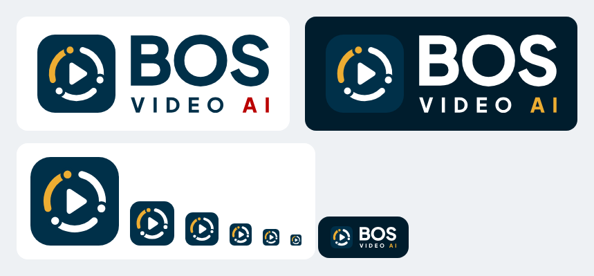
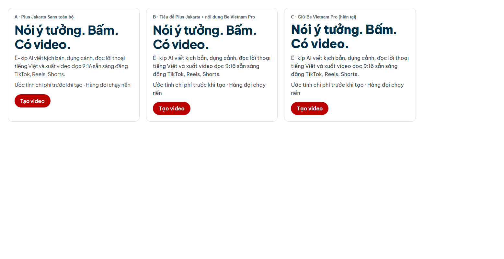

# BOS Video AI – Brand guideline

Bộ nhận diện chính thức của BOS Video AI (bản 10/2026). Mọi file gốc nằm trong [`assets/`](assets/). Khi dùng logo, màu hoặc font ở app, landing page, tài liệu, slide hay mạng xã hội, lấy từ thư mục này; không vẽ lại, không chép mã màu từ chỗ khác.

## 1. Ý tưởng

BOS Video AI là **ứng dụng tạo video bằng AI, vận hành bằng một ê-kíp AI agent**: giám đốc sáng tạo, người phản biện, biên kịch, đạo diễn, dựng phim. Mỗi agent làm một việc rồi chuyển cho agent kế tiếp; cả vòng lặp lên kế hoạch → làm → tự kiểm tra cho ra một video.

Logo **"Agent Loop"** vẽ đúng điều đó:

- **3 cung** chạy vòng = các agent nối tiếp nhau trong một vòng lặp tự vận hành (Agentic AI).
- **Node ở đầu mỗi cung** = một agent đang trao việc.
- **Cung vàng** = agent đang làm, điểm nhấn của AI.
- **Nút play ở tâm** = thứ được tạo ra: video.

Tính cách thương hiệu: hiện đại, rõ ràng, thân thiện với người bán hàng không rành công nghệ. Nói kết quả ("có video để đăng"), không nói thuật ngữ.

## 2. Logo

| File | Dùng khi |
|---|---|
| [`icon.svg`](assets/icon.svg) | Icon, hiển thị từ **40px trở lên** (app icon, avatar, splash) |
| [`icon-small.svg`](assets/icon-small.svg) | Icon **16–32px** (favicon, taskbar, nav). Nét dày hơn để không nhoè |
| [`icon-512.png`](assets/icon-512.png), [`icon-1024.png`](assets/icon-1024.png) | Nơi không nhận SVG: avatar mạng xã hội, store, slide |
| [`wordmark.svg`](assets/wordmark.svg) | Chữ trên **nền sáng**: navy, "AI" đỏ |
| [`wordmark-inverse.svg`](assets/wordmark-inverse.svg) | Chữ trên **nền tối**: trắng, "AI" vàng |
| [`lockup.png`](assets/lockup.png), [`lockup-inverse.png`](assets/lockup-inverse.png) | Icon + chữ, nền trong suốt, cho tài liệu và slide |
| [`wordmark-lockup-master.html`](assets/wordmark-lockup-master.html) | Master để render lại lockup bằng trình duyệt |

**Wordmark**: "BOS" ở trên, "VIDEO AI" giãn chữ ở dưới, hai dòng cùng bề rộng. Font Plus Jakarta Sans ExtraBold đã chuyển thành path, nên hiển thị giống nhau ở mọi máy và mọi ngôn ngữ.

**Lockup ngang**: icon bên trái, wordmark bên phải, **cùng chiều cao**, khoảng cách = 0,2 × chiều cao.

**Khoảng trống quanh logo**: tối thiểu bằng 1/4 chiều cao icon ở mọi phía.

**Cỡ tối thiểu**: icon 16px (dùng `icon-small.svg`); lockup cao 24px trên màn hình, 10mm khi in.

**Không được**:

- Đổi màu từng phần, thêm viền, bóng, gradient hay hiệu ứng.
- Kéo giãn, xoay, nghiêng, hoặc đổi thứ tự 3 cung.
- Đặt wordmark sáng trên nền tối hoặc ngược lại. Luôn chọn đúng biến thể theo nền.
- Gõ lại chữ "BOS Video AI" bằng font khác để thay wordmark.
- Đặt logo lên ảnh rối mà không có nền navy hoặc lớp phủ đủ tương phản.

## 3. Màu

Bảng màu kế thừa thương hiệu mẹ BOS (web-bo-shop), **không đổi**.

| Vai trò | Mã | Dùng cho |
|---|---|---|
| Navy (chủ đạo) | `#003049` | Nền icon, chữ chính, sidebar, nút thường |
| Navy đậm | `#001D2D` | Chữ nội dung, nền tối của landing |
| Đỏ BOS | `#BA0000` | Chữ "AI" trên nền sáng, nút tạo/tốn tiền, lỗi |
| Vàng | `#EDAD32` | Cung agent, chữ "AI" trên nền tối, nút chính của landing, mục đang chọn |
| Trắng | `#FFFFFF` | Cung, play và chữ trên nền navy |
| Nền sáng | `#F7F7F9` | Nền app |
| Chữ phụ | `#4D5D69` | Mô tả, chú thích (tương phản ≥ 4,5:1 trên trắng) |

Tỉ lệ gợi ý trên một màn hình: navy và trung tính chiếm khoảng 80%, vàng khoảng 15%, đỏ dưới 5% (chỉ những chỗ cần nổi bật nhất). Không đặt đỏ cạnh vàng ở diện tích lớn.

### Màu giao diện app (Boutique Hotel, từ bản 0.1.9)

Giao diện app dùng một bảng màu riêng, trầm và sang hơn, dựng trên bảng thương hiệu ở trên. Logo, icon và motif Agent Loop vẫn dùng đúng màu thương hiệu; bảng dưới đây chỉ dành cho màn hình app (nền, chữ, nút, trạng thái).

| Vai trò | Mã | Dùng cho |
|---|---|---|
| Navy khách sạn | `#0A1E2E` | Thanh menu bên trái, tiêu đề, chữ trên nút vàng |
| Navy nhạt | `#17344B` | Hover và đường kẻ trên nền navy |
| Vàng đồng | `#CBA135` | Nút chính hằng ngày, mục đang chọn, tiến độ, điểm nhấn trên navy |
| Vàng đồng hover | `#B98F27` | Nút chính khi rê chuột |
| Vàng chữ | `#7A5A12` | Nhãn nhỏ và chữ vàng trên nền sáng (tương phản ≥ 4,5:1) |
| Đỏ BOS | `#BA0000` | Chỉ nút tạo video / tốn credit và viền nút xoá |
| Kem | `#F6F1E4` | Nền app, tiêu đề trên nền navy |
| Trắng | `#FFFFFF` | Thẻ, ô nhập |
| Kem đậm | `#F1ECE0` | Nền phụ (khung xem trước, vùng phụ) |
| Chữ nội dung | `#22303D` | Đoạn văn |
| Chữ phụ | `#5F6977` | Mô tả, chú thích |
| Chữ menu | `#B4BEC8` | Chữ thường trên thanh menu navy |
| Đường kẻ | `rgba(10,30,46,0.12)` | Viền thẻ, gạch chân ô nhập |
| Xanh "xong" | `#2F7D5F` | Chấm trạng thái thành công |
| Vàng cảnh báo | `#9A6A0C` | Chấm và nền cảnh báo |
| Đỏ lỗi | `#B3261E` | Chấm và viền lỗi |
| Xám chờ | `#8A929C` | Đang chờ / chưa rõ |

Quy tắc của giao diện app:

- Góc bo 2px, ô nhập dạng gạch chân, nhãn nhỏ viết hoa giãn chữ.
- Vàng đồng là nút chính thường ngày (chữ navy). Đỏ chỉ dành cho hành động tạo video hoặc tốn credit, và viền của nút xoá. Mỗi màn hình có tối đa một nút đỏ.
- Tiêu đề màn hình dùng Plus Jakarta Sans độ đậm 500 (nhẹ hơn tiêu đề landing), nội dung dùng Be Vietnam Pro.
- Ít chữ: mỗi màn hình một câu dẫn ngắn, giữ thông điệp bosvideo.net ("Nói ý tưởng. Bấm. Có video.").
- Ảnh trên thẻ chung (không thuộc một ngành) dùng biểu tượng trung tính, không dùng ảnh riêng của một ngành.

## 4. Chữ

| Vai trò | Font | Độ đậm |
|---|---|---|
| Tiêu đề, nút, con số lớn, giá | **Plus Jakarta Sans** | 800 tiêu đề, 700 nút và số |
| Nội dung, nhãn, form, phụ đề | **Be Vietnam Pro** | 400 / 600 / 700 |

- Cả hai đều có đủ glyph tiếng Việt và dùng giấy phép SIL OFL 1.1. Font tiêu đề đã được cắt gọn (Latin + tiếng Việt) cho app chạy offline: [`assets/fonts/`](assets/fonts/).
- Tiêu đề lớn: giãn chữ khoảng -0,02em. Đoạn văn: không giãn, cao dòng 1,5.
- Không dùng Plus Jakarta Sans cho đoạn văn dài tiếng Việt ở cỡ nhỏ (dấu nhỏ, khó đọc).

## 5. Motif Agent Loop

Vòng 3 cung + node, có hoặc không có nút play ở giữa, dùng làm **chỉ báo "AI đang làm việc"**:

- Trạng thái đang tạo video, hàng đợi đang chạy, màn hình khởi động: xoay đều (khoảng 1,6–3 giây/vòng).
- Điểm nhấn trước tiêu đề nói về ê-kíp AI: xoay chậm (khoảng 9 giây/vòng), cỡ bằng chiều cao dòng chữ.
- Người dùng bật giảm chuyển động (`prefers-reduced-motion`) thì vòng đứng yên.
- Trên nền sáng: cung trắng đổi thành navy, cung vàng giữ nguyên.
- Không dùng làm hoa văn nền lặp lại, không phóng to làm hình nền.

## 6. Lời giới thiệu sản phẩm

Dòng mô tả cố định đi cùng logo khi cần nói rõ sản phẩm là gì:

- Tiếng Việt: **Ứng dụng tạo video bằng AI**
- Tiếng Anh: **AI video maker**
